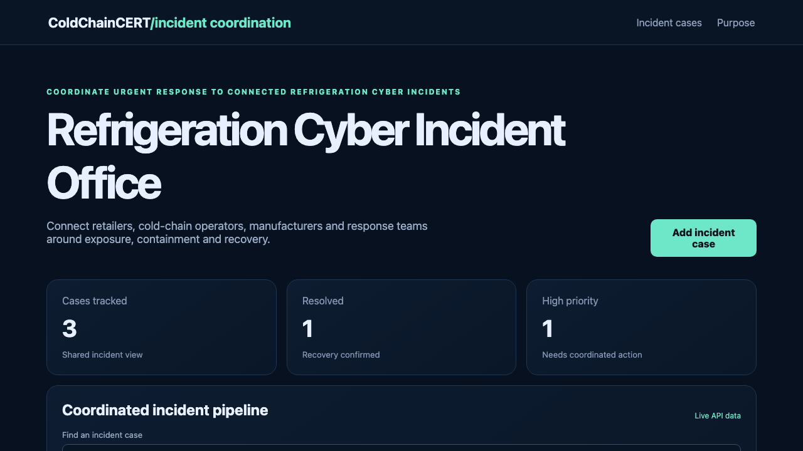

# Refrigeration Cyber Incident Office

## One-sentence benefit

Coordinate connected refrigeration incidents from first exposure through verified recovery without losing ownership or evidence.

## Live demo

[Watch the workflow](docs/demo.webm).

## Screenshots

## Main features

- Search and sort a shared incident pipeline.
- Create validated incident cases with accountable owners and priorities.
- Move cases through draft, review and resolved states.
- See loading, empty, error and success feedback.
- Use separate incident and purpose pages on desktop or mobile.

## Technology used

React, TypeScript, TanStack Query, Wouter, Vite, Spring Boot and Java 21.

## Installation instructions

Install Node.js 22 and Java 21. Run `npm install`, then start the backend with `cd backend && mvn spring-boot:run`. In another terminal run `npm run dev`.

## Commercial licensing/contact

Commercial licensing and integration support are available. Use the repository contact options to discuss deployment.

## Business problem and users

Retailers, cold-chain operators, manufacturers, CSIRTs and public authorities need one view of affected systems, responsible teams and recovery progress during coordinated incidents.

## Key workflows

Search the incident register, open a validated case, assign its response owner, advance it after evidence review and confirm the change through the live Java API.

## React framework highlights

TanStack Query manages server state and cache refreshes, Wouter provides two client routes, and typed React forms drive API writes.

## Java backend highlights

Spring Boot exposes list, search, create and update endpoints, Bean Validation returns clear errors, Actuator provides health status, and service tests cover domain behaviour.

## Architecture and state flow

React reads and writes `/api/items`. Vite proxies requests to Spring Boot. The controller validates input, the service applies domain transitions and the in-memory data layer returns the updated record.

## Accessibility and responsive behaviour

Semantic landmarks, visible labels, keyboard-ready controls, strong focus states and responsive cards support narrow and wide screens.

## Verification commands

Run `npm test`, `npm run lint`, `npm run build`, `cd backend && mvn test` and `cd backend && mvn package`.

## Structure

`src` contains the React application, `backend` contains the Java service, and `docs` contains inspected product media.

## Tradeoffs

The sample stores data in memory so it is easy to run. Production use should add authenticated users, persistent storage and event integration.

## Roadmap

Add incident exchange feeds, manufacturer advisories, evidence attachments and role-based response approvals.
